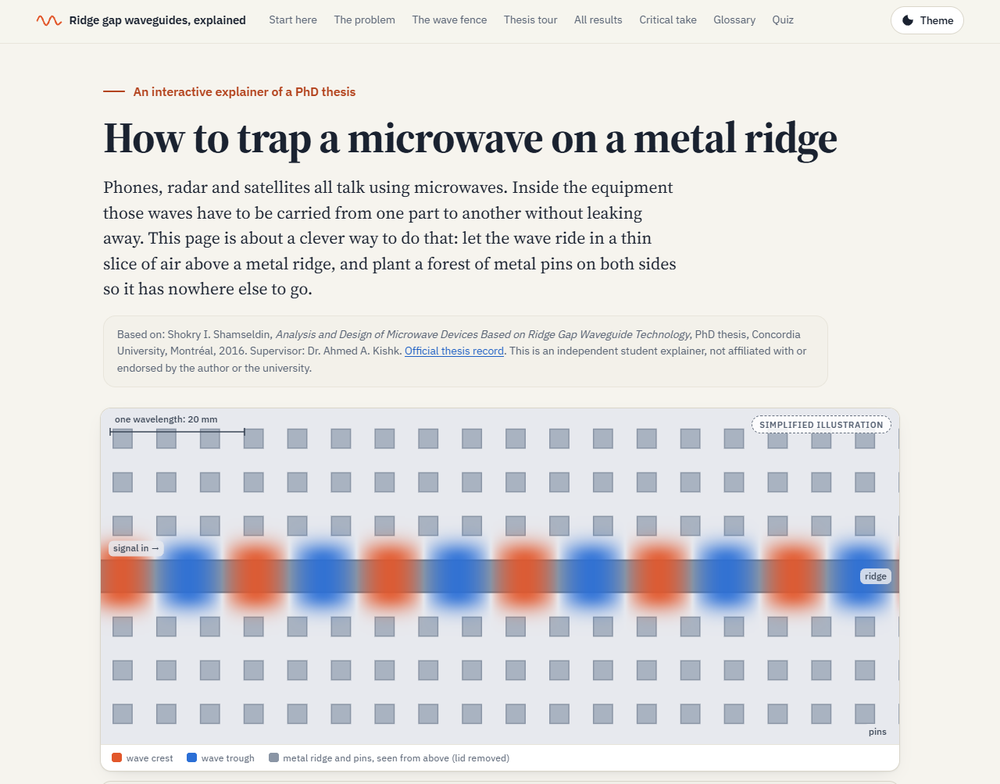

# How to trap a microwave on a metal ridge

An interactive, scrollable explainer of a PhD thesis on ridge gap waveguides, written for people
with no electrical engineering background.

**Live page: https://ved-cmpt.github.io/rgw-explainer/**

[](https://ved-cmpt.github.io/rgw-explainer/)

## What this is

Phones, radar and satellites all use microwaves, and inside the equipment those waves have to be
carried from one part to another without leaking away. A **ridge gap waveguide** does this in an
unusual way: the wave rides in a thin slice of air above a metal ridge, and rows of metal pins on
both sides (a "bed of nails") stop it from spreading sideways. The lid never has to touch the
rest, which makes the structure easier to build than a classic metal waveguide.

This page explains one PhD thesis on that technology:

> Shokry I. Shamseldin, *Analysis and Design of Microwave Devices Based on Ridge Gap Waveguide
> Technology*, PhD thesis, Concordia University, Montréal, 2016. Supervisor: Dr. Ahmed A. Kishk.

It is aimed at students and curious readers who have never studied electrical engineering, while
staying accurate enough for a specialist. Each section starts with an everyday picture, then
introduces the real term, then gives the thesis result. Optional "Go deeper" boxes hold the
equations and decibel levels, so beginners are not overwhelmed and experts still get substance.

## What you can explore

- **Trapped or leaking wave.** Slide the frequency and the air gap and watch the wave stay on the
  ridge or spread out through the pins.
- **Wavelength ruler.** See how the length of one wave shrinks as frequency rises.
- **Three ways to carry a microwave.** Flip a switch to open a hairline crack in a hollow metal
  waveguide and see why the ridge gap design does not care.
- **Pin-fence calculator.** Set the pin height and gap, get the rule-of-thumb stop band, and
  compare it with what the thesis's full simulations found for its own pins.
- **Connector bandwidth chart.** How much of the available band old and new connectors use.
- **Counting ripples.** Sweep a test frequency and build a dispersion curve one dot per peak,
  the idea behind the thesis's band-gap measurement.
- **Band-gap schematic.** Toggle the ridge on and watch the usable band shrink.
- **Pin shapes.** Five shapes compared, alone and with the ridge.
- **Circulator roundabout.** Send a signal into any port, flip the magnet, remove it.
- **Fabric measurement.** Pick a sample and see how its permittivity falls out of two lines.
- **Beam-steering antenna.** Change the frequency and the beam leans over.
- **Results chart.** Every working frequency range on one chart, marked measured or simulated,
  with a table view and page references.
- **Glossary.** 36 plain-language entries. Dotted-underlined words show their definition on
  hover, tap or keyboard focus.
- **Quiz.** Seven questions with instant feedback and explanations.

## Page structure

| # | Section | What it covers |
|---|---------|----------------|
| 1 | Hero | The title, credits and the animated wave on the ridge |
| 2 | Start here | What a microwave signal is and why it needs a guide |
| 3 | The problem it solves | Microstrip, hollow waveguide and ridge gap waveguide side by side |
| 4 | The wave fence | How a row of pins can stop a wave, and the band-gap calculator |
| 5 | Thesis tour | A map of the chapters as stops on a signal's journey |
| 6 | Chapter 2 · Getting in and out | Connectors that use the whole band |
| 7 | Chapter 3 · Knowing the fence | Measuring the band gap, the effect of the ridge, pin shapes |
| 8 | Chapter 4 · Splitting and sharing | A power divider and a 3-dB hybrid coupler |
| 9 | Chapter 5 · One-way traffic | The circulator |
| 10 | Chapter 6 · Putting it to work | Measuring fabric and steering an antenna beam |
| 11 | All results at a glance | One chart of every frequency band, measured or simulated |
| 12 | Critical take | Strengths, limitations, future work and discussion questions |
| 13 | Glossary | Every technical term in plain words |
| 14 | Self-check | The seven-question quiz |
| 15 | Footer | Full citation, link to the thesis and the not-affiliated note |

## How it's built

- **Plain HTML, CSS and vanilla JavaScript.** No framework, no build step, no dependencies.
- **Three files:** `index.html` (content), `styles.css` (layout and themes), `script.js`
  (every interactive diagram).
- **No external images.** Every diagram is drawn in code with SVG or canvas.
- **Responsive** from a 360 px phone to a large desktop screen. The bigger diagrams switch to a
  dedicated phone layout instead of just shrinking.
- **Light and dark themes** that follow the system setting, plus a manual toggle.
- **Reduced motion** is respected: animations stop and diagrams show their end state.
- **Keyboard accessible:** real labels on every control, visible focus, sliders and buttons
  usable without a mouse, tooltips that close with Escape.
- **Works offline.** Fonts come from Google Fonts when online and fall back to system fonts
  otherwise.
- Hosted on GitHub Pages straight from the `main` branch.

## Run locally

```bash
git clone https://github.com/ved-cmpt/rgw-explainer.git
cd rgw-explainer
```

Then double-click `index.html`, or serve the folder if you prefer a local address:

```bash
python -m http.server 8000
# open http://localhost:8000
```

## Accuracy

- Every number on the page was checked against the thesis, and most carry a chapter or page
  reference next to them.
- Results are marked **Measured** (tested on real hardware) or **Simulated** (computer
  simulation only), on the chart and beside individual claims.
- Visuals that use toy physics to build intuition are labelled "Simplified illustration",
  "Schematic" or "Illustrative angle". They are not simulations.
- Where the thesis leaves something unstated, the page says so instead of guessing. For example,
  it does not claim that two similar pin designs from different chapters are the same one.
- If you find a mistake, it is mine and not the thesis's. Issues and corrections are welcome.

## Credits and licence

**Thesis.** Shokry I. Shamseldin, *Analysis and Design of Microwave Devices Based on Ridge Gap
Waveguide Technology*, PhD thesis, Department of Electrical and Computer Engineering, Concordia
University, Montréal, Québec, Canada, 2016. Supervisor: Dr. Ahmed A. Kishk.
Official record: https://spectrum.library.concordia.ca/id/eprint/981921/

**Not affiliated.** This is an independent student explainer by
[ved-cmpt](https://github.com/ved-cmpt). It is not affiliated with or endorsed by the author or
Concordia University.

**Thesis content belongs to its author.** The ideas, results and numbers are the thesis's. The
explanations here are in my own words. Apart from two short cited quotes, no thesis text is
reproduced, and no thesis figures are used.
The thesis itself is not part of this repository.

**Licence.** The code in this repository is released under the [MIT License](LICENSE). That
licence covers the code only.
